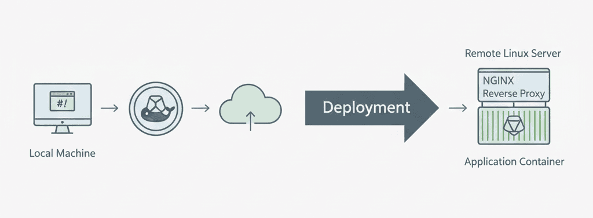

# Jeremiah Inyiama

### IT & Network Support Specialist | Network Infrastructure | AWS Certified

IT and Network Support professional with 4+ years of combined experience across enterprise IT support, network infrastructure deployment, connectivity troubleshooting, and systems support.

Hands-on experience configuring Cisco switches and Mikrotik routers, VLANs, access and trunk ports, IP addressing, subnetting, static routes, and inter-VLAN routing. Experienced in installing and configuring routers, switches, and wireless access points; troubleshooting network services and connectivity; and validating infrastructure deployments.

AWS Certified Solutions Architect – Associate and AWS Certified Cloud Practitioner, with practical projects in Linux networking, cloud networking concepts, containerized deployments, and infrastructure automation.

**Career direction:** Building on practical networking and IT infrastructure experience to develop deeper capabilities in cloud networking, cloud infrastructure, and DevOps.

      

---

## Selected Impact

- **4+ years** of combined IT support, systems, and networking experience across internship and professional environments.
- Resolved **250+ technical support tickets** involving network connectivity, operating-system issues, endpoint devices, printers, and user-account access.
- Supported IT infrastructure rollouts across **three branch locations**, including network devices, endpoints, and LAN infrastructure.
- Personally installed and configured network devices and validated connectivity during infrastructure deployment activities.
- Contributed to an office network expansion delivered in **12 days against a planned 20-day delivery period**.
- Helped improve managed-network support operations, with an approximately **40% reduction in average response time**.
- AWS Certified Solutions Architect – Associate and AWS Certified Cloud Practitioner.

---

## Technical Skills

### Networking & Infrastructure

- **Switching:** Cisco switch configuration, VLAN creation and assignment, access ports, trunk ports, and switch-level troubleshooting.
- **Routing:** IP addressing, subnetting, static routes, inter-VLAN routing, and gateway connectivity.
- **Network services:** DHCP, DNS, NAT, and firewall rules.
- **Infrastructure:** Router, switch, and wireless access-point installation and configuration; LAN deployment; structured cabling; and fiber connectivity support.
- **Troubleshooting:** `ping`, `tracert`, `ipconfig`, `nslookup`, `arp`, and Cisco switch CLI.
- **Operations:** Network fault isolation, connectivity validation, ISP coordination, escalation, and technical documentation.
- **Linux networking labs:** Network namespaces, bridges, virtual Ethernet pairs, routing, `iptables`, and NAT.

### IT Systems & End-User Support

- Windows 10/11 support and administration.
- Hardware, software, operating-system, printer, and peripheral troubleshooting.
- User onboarding, account setup, access management, and permissions.
- POS systems, Microsoft Dynamics 365, retail hardware, label printers, and Mettler Toledo scales.
- Ticket handling, escalation, IT asset inventory, and technical documentation.
- Tools and platforms: Active Directory, Microsoft 365, Google Workspace, Freshdesk, remote-support tools, and Slack.

### Cloud & DevOps

- **AWS:** EC2, IAM, S3, CloudWatch, VPC concepts, and core cloud architecture fundamentals.
- **Linux:** Command-line operations and system fundamentals.
- **Containers and web services:** Docker, Docker Compose, and NGINX.
- **Automation:** Bash scripting and Python-based project work.
- **Version control:** Git and GitHub.
- **Developing:** Infrastructure as code, CI/CD, and deeper cloud infrastructure implementation.

### Tools & Platforms

`Cisco` • `TCP/IP` • `VLAN` • `DHCP` • `DNS` • `NAT` • `Windows` • `Linux` • `Microsoft 365` • `Active Directory` • `Freshdesk` • `Bash` • `Python` • `Docker` • `NGINX` • `Git` • `GitHub` • `AWS`

  

---

## Professional Experience

### IT Support Specialist — SPAR Nigeria (Novare Mall, Abuja)

_January 2026 – Present | Abuja, Nigeria_

- Provide day-to-day IT support for POS systems, end-user devices, and retail equipment, including label printers and Mettler Toledo scales, across store and warehouse locations.
- Support Microsoft Dynamics 365 and other store-critical business applications used in daily retail operations.
- Maintain and troubleshoot LAN connectivity, investigating endpoint network issues, IP configuration, switch connectivity, and VLAN-related faults.
- Support Cisco network infrastructure and assist with isolating network-device and connectivity faults.
- Coordinate with ISPs and vendors to investigate and escalate connectivity outages affecting business operations.
- Support employee onboarding through user-account setup, email access, and permissions.
- Maintain IT asset inventory and document support activities and recurring technical issues.

### IT Support & Network Technician — VAS Technologies Ltd

_January 2023 – January 2025 | Abuja, Nigeria_

- Installed, configured, and maintained routers, Cisco switches, wireless access points, desktops, printers, and LAN infrastructure across client environments.
- Configured and supported VLANs, access and trunk ports, IP addressing, static routes, and inter-VLAN routing as required by network deployments.
- Worked with DHCP, DNS, NAT, and firewall rules during network configuration and troubleshooting.
- Used `ping`, `tracert`, `ipconfig`, `nslookup`, `arp`, and switch CLI to investigate connectivity and network-device issues.
- Supported network infrastructure rollouts across **three branch locations**, including device installation, configuration, and connectivity validation.
- Resolved **250+ technical support tickets** involving network connectivity, operating-system issues, endpoint devices, printers, and user-account access.
- Coordinated with ISPs and escalated complex faults with relevant diagnostic findings.
- Maintained network asset records, technical documentation, and support procedures.

### Network & Systems Support Intern — VAS Technologies Ltd

_July 2022 – December 2022 | Abuja, Nigeria_

- Assisted with workstation setup, imaging, cable management, and software installation.
- Supported router, printer, and basic network-device installation and configuration under supervision.
- Assisted with network connectivity checks and routine hardware and software troubleshooting.
- Logged recurring issues and documented device setups and maintenance activities.

### DevOps Trainee — HNG

_October 2025 – Present | Remote_

- Worked on automating remote deployments using Bash and Docker.
- Configured NGINX to support Blue/Green deployment concepts.
- Implemented basic log monitoring and Slack alerting for service visibility.
- Practised Linux networking concepts, including namespaces, routing, and `iptables`.
- Contributed to runbooks and reproducible deployment documentation.

---

## Networking Experience & Infrastructure Projects

### Network Configuration & Troubleshooting

My practical networking work includes configuring and supporting switching, routing, network services, and end-to-end connectivity across office and client environments.

**Switching and VLANs**

- Configured Cisco switches, including VLANs, access ports, and trunk ports.
- Supported switch connectivity and investigated port- and VLAN-related issues.
- Validated connectivity between connected devices and network segments.

**IP addressing and routing**

- Configured IP addressing and subnet assignments.
- Worked with static routes and inter-VLAN routing.
- Investigated gateway and routing-related connectivity issues.

**Network services**

- Worked with DHCP and DNS during network setup and troubleshooting.
- Configured or troubleshot NAT and firewall rules as part of network connectivity and traffic-control tasks.

**Troubleshooting tools**

- `ping` — reachability and packet-response checks.
- `tracert` — tracing network paths.
- `ipconfig` — inspecting endpoint IP configuration.
- `nslookup` — DNS resolution checks.
- `arp` — examining IP-to-MAC address mappings.
- Cisco switch CLI — inspecting and configuring switch settings.

### Enterprise Office Network Expansion & Inter-Building Connectivity

[View project documentation](https://github.com/Jerriemiah/network-optimization/blob/main/README.md)

**Objective**

Extend the existing enterprise network into a newly constructed office building and provide connectivity between the buildings within a defined delivery schedule.

**My contribution**

- Personally installed and configured network devices as part of the infrastructure deployment.
- Supported inter-building fiber connectivity deployment.
- Worked on switching, routing, and network-device configuration.
- Coordinated structured cabling activities with building contractors.
- Supported wireless infrastructure deployment.
- Validated wired and wireless connectivity across the required areas.

**Outcome**

The network expansion was delivered in **12 days against a planned 20-day delivery period**.

**Technical areas**

`Fiber Connectivity` • `Cisco Switching` • `Routing` • `LAN` • `Wireless Infrastructure` • `Structured Cabling`

### Linux Virtual Private Cloud (VPC) Simulation — vpcctl

[View project on GitHub](https://github.com/Jerriemiah/vpcctl/blob/main/README.md)

Built a Linux-based lab that recreates core VPC networking concepts using network namespaces, virtual Ethernet pairs, bridges, routing tables, firewall rules, and NAT.

**What I built**

- Built a custom CLI tool (`vpcctl`) to manage simulated VPC environments.
- Created isolated Linux network namespaces to represent separate VPCs and subnets.
- Configured bridges, virtual Ethernet pairs, IP addressing, and routing tables.
- Implemented subnet isolation, optional peering, firewall rules, and NAT.
- Added lifecycle cleanup for simulated network resources.

**Architecture**

Linux network namespaces represent isolated network environments. Virtual Ethernet pairs connect namespaces to Linux bridges, while routing and `iptables` rules control traffic between network segments.

**Validation**

- Tested connectivity and routing between configured network segments.
- Tested subnet isolation and traffic behavior under configured firewall rules.
- Verified lifecycle cleanup of created networking resources.

**Technologies**

`Linux` • `Bash` • `Python` • `iproute2` • `iptables`

---

## Cloud & DevOps Projects

### Blue/Green Deployment with Observability & Auto-Failover

[View project on GitHub](https://github.com/Jerriemiah/hng-stage2-bluegreen/blob/main/README.md)

**Objective**

Explore a controlled application deployment approach that allows traffic to be switched between application environments and makes service events easier to detect.

**What I built**

- Implemented a Blue/Green deployment architecture using Docker Compose and NGINX upstreams.
- Configured NGINX to route traffic between application environments.
- Added structured NGINX logging.
- Built a Python-based log watcher to detect failovers and error-rate spikes.
- Configured Slack alerts to improve visibility into service events.
- Documented deployment procedures and operational behavior.

**Validation**

- Simulated service outages and tested traffic failover.
- Recorded zero failed client requests during the simulated outage tests.
- Verified that the log watcher detected configured events and sent Slack alerts.

**Limitations / improvements**

- Expand health checks and automated recovery scenarios.
- Add more comprehensive monitoring and alert thresholds.
- Test behavior under a wider range of load and failure conditions.

**Technologies**

`Docker Compose` • `NGINX` • `Python` • `Linux` • `Slack`

### Automated Deployment Bash Script

[View project on GitHub](https://github.com/Jerriemiah/hng-stage1-devops-deploy/blob/main/README.md)

**Objective**

Make remote server preparation and application deployment more repeatable through scripting.

**What I built**

- Developed an executable Bash script for remote environment preparation.
- Automated deployment of a Dockerized application.
- Automated NGINX reverse-proxy configuration.
- Included validation, logging, and safe re-runs in the deployment workflow.

**Validation**

- Ran the deployment workflow and checked the resulting application and proxy configuration.
- Included logging and validation steps to make execution easier to inspect.

**Limitations / improvements**

- Expand error handling and rollback behavior.
- Add automated tests for more deployment failure scenarios.
- Integrate the workflow with a CI/CD pipeline.

**Technologies**

`Bash` • `Docker` • `NGINX` • `Linux`

---

## IT Support & Operations Projects

### IT Infrastructure & System Configuration Overhaul

[View project on GitHub](https://github.com/Jerriemiah/it-infrastructure-overhaul/blob/main/README.md)

**Problem**

Inconsistent workstation and peripheral setups contributed to recurring support issues, performance problems, and downtime.

**Approach**

Supported structured setup and configuration of desktops, printers, and network devices, with emphasis on standardization, repeatable installation steps, and clear documentation.

**Outcome**

Improved system reliability, reduced repeat configuration issues, and strengthened operational consistency through standardized processes.

**Skills**

System administration, troubleshooting, documentation, and IT operations.

### Customer Support & Managed Network Service Improvement

[View project on GitHub](https://github.com/Jerriemiah/managed-network-support-process-improvement/blob/main/README.md)

**Problem**

Manual incident logging and inconsistent escalation processes limited visibility and contributed to slow response times in managed-network support operations.

**Approach**

Implemented Freshdesk as a centralized ticketing system, introduced ticket categorization and prioritization, automated responses for common issues, and defined escalation workflows for critical incidents.

**Outcome**

Reduced average response time by approximately **40%**, improved communication with supported sites during outages, and increased support efficiency.

**Skills**

IT support operations, incident management, escalation workflows, customer communication, and process improvement.

---

## Certifications

- [**AWS Certified Solutions Architect – Associate**](https://www.credly.com/badges/f38cf166-b571-447e-924f-ea544381333a/public_url) — Amazon Web Services (2025)
- [**AWS Certified Cloud Practitioner**](https://www.credly.com/badges/22f4e75d-bdf8-45f6-aeef-0c6161bb4b48/public_url) — Amazon Web Services (2025)
- [**Google IT Support Professional Certificate**](https://coursera.org/share/9fdbdbd298a49e4ed20075fbb66b4c99) — Google / Coursera (2022)

---

## Current Focus

- Deepening practical networking knowledge through hands-on switching, routing, VLAN, and network-services work.
- Building on Linux networking and AWS knowledge to develop cloud networking and infrastructure skills.
- Improving deployment automation, infrastructure as code, and CI/CD capabilities.

---

## Contact

      
