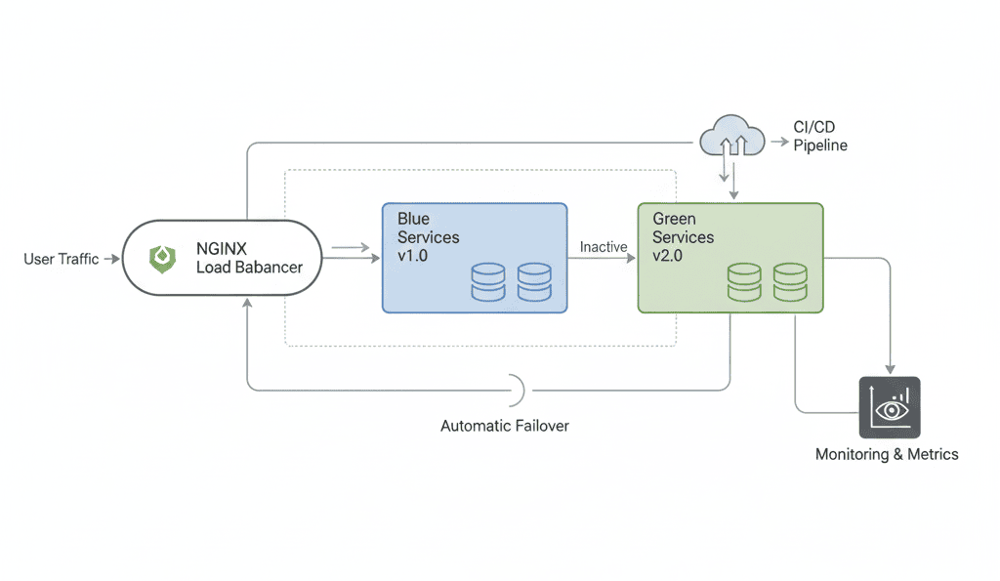
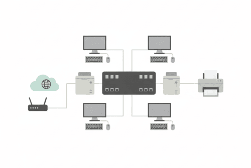
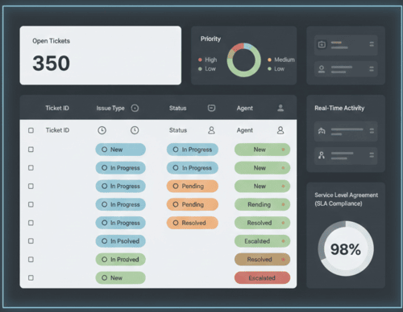

# Jeremiah Inyiama

### IT & Network Support Specialist | AWS Certified | Linux, Networking & Automation

I support business-critical users, systems, and network infrastructure across retail and managed-service environments. My work includes troubleshooting endpoint and connectivity issues, supporting business applications and POS systems, maintaining LAN infrastructure, coordinating with service providers, and documenting technical operations. Alongside my professional experience, I build practical projects in Linux networking, AWS, Docker, and deployment automation.

I am targeting **IT Support, Network Support, Systems Support, Junior Cloud Support, and Junior DevOps** roles.

---

## Selected Impact

- **4+ years** of progressive IT support and network-support experience, including internship and professional roles.
- Resolved **250+ technical support tickets** involving connectivity, operating-system issues, endpoint devices, printers, and user accounts.
- Supported IT infrastructure rollouts across **three branch locations**, including routers, printers, desktops, and LAN infrastructure.
- Contributed to an office network expansion that was completed **12 days against a planned 20-day delivery period**.
- Helped improve managed-network support operations, with an approximately **40% reduction in average response time**.
- AWS Certified Solutions Architect – Associate and AWS Certified Cloud Practitioner.

---

## How to Read This Portfolio

- **For IT Support / Service Desk roles:** Start with [Professional Experience](#professional-experience) and [IT Support & Systems Projects](#it-support--systems-projects).
- **For Network Support / NOC roles:** Start with [Networking Experience & Evidence](#networking-experience--evidence) and [Featured Projects](#featured-projects).
- **For Cloud / DevOps roles:** Start with [Featured Projects](#featured-projects), [Certifications](#certifications), and [Cloud & Infrastructure Projects](#cloud--infrastructure-projects).
- **For technical detail:** Open a project repository to review its README, configuration files, architecture, and validation notes.

---

## Featured Projects {#featured-projects}

### 1. [Linux Virtual Private Cloud (VPC) Simulation — vpcctl](https://github.com/Jerriemiah/vpcctl/blob/main/README.md)

Built a Linux-based lab that recreates core VPC networking concepts using network namespaces, virtual Ethernet pairs, bridges, routing tables, firewall rules, and NAT.

**Demonstrates:** Linux networking, subnet isolation, routing, firewalling, NAT, and infrastructure lifecycle management.

### 2. [Blue/Green Deployment with Observability & Auto-Failover](https://github.com/Jerriemiah/hng-stage2-bluegreen/blob/main/README.md)

Implemented a containerized Blue/Green deployment architecture using Docker Compose and NGINX, with automated log monitoring and Slack alerts for failovers and error-rate spikes.

**Demonstrates:** Docker, NGINX, deployment strategies, failover, logging, observability, and automation.

### 3. [Enterprise Office Network Expansion & Inter-Building Connectivity](https://github.com/Jerriemiah/network-optimization/blob/main/README.md)

Supported the expansion of an enterprise office network, including inter-building fiber connectivity, switching, routing, structured cabling, and wireless access.

**Demonstrates:** Enterprise networking, infrastructure deployment, wireless connectivity, structured cabling, and cross-team coordination.

---

## Professional Experience {#professional-experience}

### IT Support Specialist — SPAR Nigeria (Novare Mall, Abuja)

_December 2025 – Present | Abuja, Nigeria_

- Provide day-to-day IT support for POS systems, end-user devices, and retail equipment, including label printers and Mettler Toledo scales, across store and warehouse locations.
- Support Microsoft Dynamics 365 and other store-critical business applications used in daily retail operations.
- Support employee onboarding by configuring user accounts, email access, and permissions.
- Maintain and troubleshoot LAN infrastructure, including Cisco switches, VLANs, IP addressing, and connectivity issues.
- Coordinate with ISPs and vendors to diagnose and escalate connectivity issues affecting business operations.
- Maintain IT asset inventory and document support activities and recurring technical issues.

### IT Support & Network Technician — VAS Technologies Ltd

_January 2023 – January 2025 | Abuja, Nigeria_

- Resolved **250+ technical support tickets** involving connectivity, operating-system issues, endpoint devices, printers, and user-account access.
- Installed and maintained routers, switches, access points, desktops, printers, and basic LAN infrastructure.
- Supported employee onboarding by configuring user accounts, email access, and permissions.
- Performed connectivity diagnostics, device configuration, and escalation of complex issues with supporting logs and documentation.
- Assisted with IT infrastructure rollouts across **three branch locations**.
- Maintained IT asset inventory and documented support procedures.

### Network & Systems Support Intern — VAS Technologies Ltd

_July 2022 – December 2022 | Abuja, Nigeria_

- Assisted with workstation setup, imaging, cable management, and software installation.
- Supported router, printer, and basic network configurations under supervision.
- Logged recurring issues to help identify common failure patterns.
- Participated in upgrade and maintenance activities and documented device setups.

### DevOps Engineer Intern — HNG

_October 2025 – Present | Remote_

- Worked on automating remote deployments using Bash and Docker.
- Configured NGINX to support Blue/Green deployment concepts.
- Implemented basic log monitoring and Slack alerting for service visibility.
- Explored Linux networking concepts, including namespaces, routing, and iptables.
- Contributed to runbooks and reproducible deployment documentation.

---

## Networking Experience & Evidence {#networking-experience-evidence}

### What I Work With

- LAN installation, troubleshooting, and maintenance.
- Cisco switch support and VLAN configuration.
- IP addressing, subnetting fundamentals, and connectivity diagnostics.
- Router, access-point, printer, and endpoint network configuration.
- Structured cabling and inter-building connectivity support.
- Wireless network troubleshooting and access-point installation.
- ISP coordination, outage escalation, and vendor follow-up.
- Network asset tracking and technical documentation.

### Typical Troubleshooting Workflow

1. Confirm the scope of the issue: one user, one device, a network segment, a site, or an ISP connection.
2. Check physical connectivity, device status, IP configuration, and basic network reachability.
3. Use tools such as `ping`, `tracert`, `ipconfig`, DNS checks, and ARP checks where appropriate.
4. Isolate whether the issue is related to the endpoint, LAN, wireless network, DNS, DHCP, firewall, or ISP.
5. Escalate to the ISP, vendor, or senior engineer with clear symptoms, diagnostic findings, and business impact.
6. Document the resolution and update relevant asset or support records.

### Practical Networking Evidence

- **[Enterprise Office Network Expansion & Inter-Building Connectivity](https://github.com/Jerriemiah/network-optimization/blob/main/README.md):** Supported fiber connectivity, switching and routing deployment, structured cabling coordination, and wired and wireless network validation.
- **[Linux VPC Simulation — vpcctl](https://github.com/Jerriemiah/vpcctl/blob/main/README.md):** Built isolated Linux network environments and configured bridges, virtual Ethernet pairs, routing, firewall rules, and NAT.

---

## Technical Skills {#technical-skills}

### IT Support & Systems

- L1 / L2 technical support and troubleshooting across hardware, software, operating systems, and user access.
- Windows administration and endpoint support.
- User onboarding, account setup, access control, and permissions.
- POS systems, Microsoft Dynamics 365, retail hardware, label printers, and Mettler Toledo scales.
- Printer, desktop, and peripheral troubleshooting.
- Ticket handling, escalation, IT asset inventory, and technical documentation.
- Tools and platforms: Active Directory, Microsoft 365, Google Workspace, Freshdesk, remote-support tools, and Slack.

### Networking

- LAN and Wi-Fi troubleshooting.
- IP addressing and subnetting fundamentals.
- Router, switch, and access-point installation and configuration.
- Cisco switch support and VLAN configuration.
- Firewall fundamentals, VPN and connectivity diagnostics.
- Structured cabling, fiber connectivity, and ISP escalation.
- Linux networking lab work: network namespaces, bridges, virtual Ethernet pairs, routing, iptables, and NAT.

### Cloud & Automation

- **AWS:** EC2, IAM, S3, CloudWatch, VPC concepts, and core cloud architecture fundamentals.
- **Linux:** command-line operations and system fundamentals.
- **Automation:** Bash scripting and Python-based project work.
- **Containers and web services:** Docker, Docker Compose, and NGINX.
- **Version control:** Git and GitHub.
- **Developing:** infrastructure as code, CI/CD, and deeper cloud infrastructure implementation.

### Tools & Platforms

`Windows` • `Microsoft 365` • `Active Directory` • `Freshdesk` • `Google Workspace` • `Cisco` • `Linux` • `Bash` • `Python` • `Docker` • `Docker Compose` • `NGINX` • `Git` • `GitHub` • `AWS`

  

---

## Certifications {#certifications}

- [**AWS Certified Solutions Architect – Associate**](https://www.credly.com/badges/f38cf166-b571-447e-924f-ea544381333a/public_url) — Amazon Web Services (2025)
- [**AWS Certified Cloud Practitioner**](https://www.credly.com/badges/22f4e75d-bdf8-45f6-aeef-0c6161bb4b48/public_url) — Amazon Web Services (2025)
- [**Google IT Support Professional Certificate**](https://coursera.org/share/9fdbdbd298a49e4ed20075fbb66b4c99) — Google / Coursera (2022)

---

## Cloud & Infrastructure Projects {#cloud-infrastructure-projects}

These projects demonstrate practical learning and implementation across Linux networking, cloud infrastructure concepts, containerization, deployment automation, and service reliability.

### [Linux Virtual Private Cloud (VPC) Simulation — vpcctl](https://github.com/Jerriemiah/vpcctl/blob/main/README.md)

**Business problem / objective**

Cloud networking concepts such as VPCs, subnets, routing, NAT, and isolation are often abstracted by cloud providers. This lab recreates core networking behavior in Linux to make those concepts easier to inspect and test.

**What I built**

- Built a custom CLI tool (`vpcctl`) to manage simulated VPC environments.
- Created isolated Linux network namespaces to represent separate VPCs and subnets.
- Configured bridges, virtual Ethernet pairs, IP addressing, and routing tables.
- Implemented subnet isolation, optional peering, firewall rules, and NAT.
- Added lifecycle cleanup for the simulated network resources.

**Architecture**

Linux network namespaces represent isolated network environments. Virtual Ethernet pairs connect namespaces to Linux bridges, while routing and iptables rules control traffic between network segments.

**Key technical decisions**

- Used native Linux networking components to expose the mechanisms behind cloud networking.
- Used namespaces to provide isolation between simulated environments.
- Used routing, firewall rules, and NAT to control connectivity between network segments.

**Validation**

- Tested connectivity and routing between configured network segments.
- Tested subnet isolation and traffic behavior under configured firewall rules.
- Verified lifecycle cleanup of created networking resources.

**Limitations / improvements**

- Extend automated tests for more complex routing and failure scenarios.
- Add clearer topology and configuration output to improve usability.
- Expand validation around edge cases in peering and network cleanup.

**Technologies**

`Linux` • `Bash` • `Python` • `iproute2` • `iptables`

**Repository**

[View project on GitHub](https://github.com/Jerriemiah/vpcctl/blob/main/README.md)

---

### [Blue/Green Deployment with Observability & Auto-Failover](https://github.com/Jerriemiah/hng-stage2-bluegreen/blob/main/README.md)

**Business problem / objective**

Application updates and service failures can cause downtime or a poor user experience when deployments lack a controlled release and failover strategy.

**What I built**

- Implemented a Blue/Green deployment architecture using Docker Compose and NGINX upstreams.
- Configured NGINX to route traffic between application environments.
- Added structured NGINX logging.
- Built a Python-based log watcher to detect failovers and error-rate spikes.
- Configured Slack alerts to improve visibility into service events.
- Documented operational procedures and deployment behavior.

**Architecture**

Docker Compose runs the application environments, while NGINX acts as the reverse proxy and traffic-switching layer. A Python log watcher observes NGINX logs and sends Slack alerts when configured conditions are detected.

**Key technical decisions**

- Used separate Blue and Green application environments to support controlled traffic switching.
- Used NGINX upstream configuration as the traffic-routing layer.
- Used log monitoring and Slack notifications to provide operational visibility during simulated events.

**Validation**

- Simulated service outages and tested traffic failover.
- Recorded zero failed client requests during the simulated outage tests.
- Verified that the log watcher detected configured events and sent Slack alerts.

**Limitations / improvements**

- Expand health checks and automated recovery scenarios.
- Add more comprehensive monitoring and alert thresholds.
- Test behavior under a wider range of load and failure conditions.

**Technologies**

`Docker Compose` • `NGINX` • `Python` • `Linux` • `Slack`

**Repository**

[View project on GitHub](https://github.com/Jerriemiah/hng-stage2-bluegreen/blob/main/README.md)

---

### [Automated Deployment Bash Script](https://github.com/Jerriemiah/hng-stage1-devops-deploy/blob/main/README.md)

**Business problem / objective**

Manual server preparation and application deployment can be repetitive, error-prone, and difficult to reproduce consistently.

**What I built**

- Developed an executable Bash script for remote environment preparation.
- Automated deployment of a Dockerized application.
- Automated NGINX reverse-proxy configuration.
- Included validation, logging, and safe re-runs in the deployment workflow.

**Architecture**

A Bash script coordinates remote environment preparation, Docker-based application deployment, NGINX configuration, and post-deployment validation.

**Key technical decisions**

- Used Bash to make the deployment workflow repeatable.
- Used Docker to package and run the application.
- Used NGINX as the reverse proxy in front of the deployed service.

**Validation**

- Ran the deployment workflow and checked the resulting application and proxy configuration.
- Included logging and validation steps to make execution easier to inspect.

**Limitations / improvements**

- Expand error handling and rollback behavior.
- Add automated tests for more deployment failure scenarios.
- Integrate the workflow with a CI/CD pipeline.

**Technologies**

`Bash` • `Docker` • `NGINX` • `Linux`

**Repository**

[View project on GitHub](https://github.com/Jerriemiah/hng-stage1-devops-deploy/blob/main/README.md)

---

## IT Support & Systems Projects {#it-support-systems-projects}

### [Enterprise Office Network Expansion & Inter-Building Connectivity](https://github.com/Jerriemiah/network-optimization/blob/main/README.md)

**Problem**

A newly constructed office building required network connectivity and integration with an existing enterprise network within a strict delivery timeline.

**Approach**

Supported the deployment of fiber connectivity between buildings, enterprise switching and routing, and wireless infrastructure. Coordinated structured cabling with building contractors and validated wired and wireless access across the required areas.

**Outcome**

The new building was connected to the existing network, with wired and wireless access delivered **12 days against a planned 20-day delivery period**, with minimal disruption to operations.

**Skills**

Enterprise networking, fiber connectivity, wireless infrastructure, infrastructure deployment, structured cabling, and cross-team coordination.

---

### [IT Infrastructure & System Configuration Overhaul](https://github.com/Jerriemiah/it-infrastructure-overhaul/blob/main/README.md)

**Problem**

Inconsistent workstation and peripheral setups contributed to recurring support issues, performance problems, and downtime.

**Approach**

Supported structured setup and configuration of desktops, printers, and network devices, with emphasis on standardization, repeatable installation steps, and clear documentation.

**Outcome**

Improved system reliability, reduced repeat configuration issues, and strengthened operational consistency through standardized processes.

**Skills**

System administration, troubleshooting, documentation, and IT operations.

---

### [Customer Support & Managed Network Service Improvement](https://github.com/Jerriemiah/managed-network-support-process-improvement/blob/main/README.md)

**Problem**

Manual incident logging and inconsistent escalation processes limited visibility and contributed to slow response times in managed-network support operations.

**Approach**

Implemented Freshdesk as a centralized ticketing system, introduced ticket categorization and prioritization, automated responses for common issues, and defined escalation workflows for critical incidents.

**Outcome**

Reduced average response time by approximately **40%**, improved communication with supported sites during outages, and increased overall support efficiency.

**Skills**

IT support operations, incident management, escalation workflows, customer communication, and process improvement.

---

## Current Focus {#current-focus}

- Strengthening Linux and networking fundamentals through hands-on project work.
- Deepening troubleshooting skills across endpoints, systems, and infrastructure.
- Improving technical documentation, repeatability, and validation practices.
- Expanding practical AWS and cloud infrastructure experience.
- Developing stronger skills in infrastructure as code, CI/CD, and deployment automation.

---

## Contact {#contact}

      
